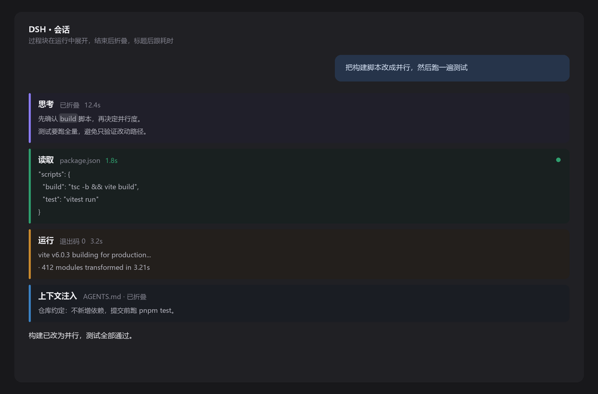
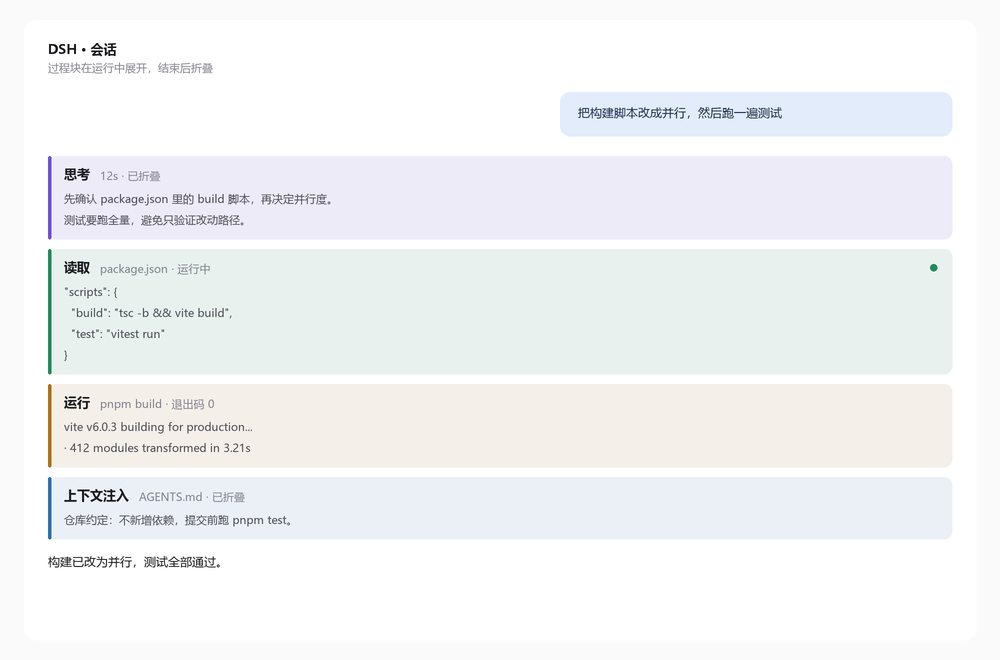
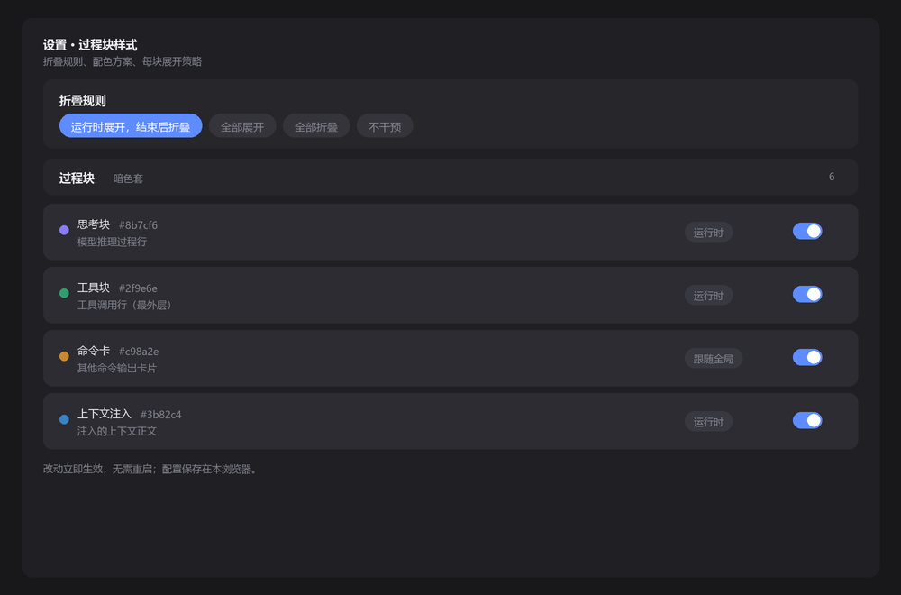

> **Languages:** [中文](README.md) · English

<div align="center">


# DSH Live Process

### Unfold the process the moment it happens


**Thinking · Tools · Commands · Context injection — open while running, fold when done**

> **Current version `1.7.1`** · Verified on the **DSH `0.2.2-rc.3`** Web UI.
> It does not take over rendering — it drives the upstream disclosure controls, so DSH upgrades usually need no plugin change.

</div>

DSH collapses every process row into a one-line summary, and while a turn is running all you see is "thinking…". This plugin unfolds each process row the moment it appears and folds it back when it settles.

**Every process row also carries an elapsed badge.** How long the thinking ran, how long that command took, how many seconds that tool call sat there — written right after the title, ticking while it runs, frozen when it settles. No switching to the trajectory tab to read "request #55 · total 3.07s · first token 3.06s", no aligning start and end times on a timeline by hand: the number sits on the row where it happened.

## 🌱 Why this exists

Let me be blunt about the motivation.

Using [pi-web](https://github.com/agegr/pi-web), it was the first time "the agent is working" felt *visible*: thinking is a block of prose that grows, a tool call is a card with its input and output, each one folds away when it settles, and the whole timeline reads like a construction log you can go back through.

Going back to DSH's built-in reasoning UI felt like the opposite — it hands you a "thinking…" shell and nothing else. When the model drops into a long, deep deliberation, nothing on screen moves except that one line: you cannot see what it is weighing, where it is stuck, or whether it has already talked itself in a circle. **An invisible process is no process at all** — by the time the conclusion lands, you have lost every basis for judging whether it is any good.

So this is not "a toggle for DSH". It is **unfolding the process the way pi-web does**: thinking, tools, commands and context injection each become their own block, open while running, folded when settled, with configurable color, tint, font size and family. One goal — every long deliberation leaves a trace you can actually read, instead of a spinning ellipsis.

> One caveat: upstream DSH deliberately does not let extensions replace the reasoning preview or the expand strategy (`dsh-client-ui-chat/README.zh.md`). So this plugin does not take over rendering — it drives upstream's own disclosure controls. See [How it works](#-how-it-works).





## ✨ Features

- **🧠 Open while running, fold when done** — a process row opens when it enters `running` and folds when it settles to `ok` / `error` / `stopped`. Rows you opened by hand are never auto-folded.
- **🎛️ Four global fold rules** — auto / expand all / collapse all / hands off.
- **🧩 Per-block override** — keep the global rule at "expand all" while a single block stays collapsed. Five modes per block: inherit / expand / collapse / auto / off.
- **🌗 Separate dark and light palettes** — the matching palette follows the UI theme automatically, or you can lock one. Each palette stores its own colors, tint strength, font size and font family.
- **🎨 Twelve configurable block types** — thinking, tools, command cards, context injection, compaction markers, process groups, turn tails, user bubbles, running status, queue, todos, steering messages.
- **📐 Adjustable geometry** — accent bar width, corner radius, block/inline/left padding, running tint strength, font size, font family.
- **🖍️ Adjustable code tint** — inline code and code blocks inside process blocks use a neutral gray derived from the text color, tunable per palette, so a white slab never surfaces inside a dark block.
- **⚡ Instant effect** — configuration lives in browser `localStorage`; no Host restart, no reinstall.
- **⏱️ Elapsed badges** — tool rows, command cards, reasoning rows and context-injection rows show their run time after the title, ticking while running and freezing when settled. Historical rows show nothing rather than a fabricated number.
- **🕗 Configurable fold timing** — "on next row" (default) keeps a finished row open until the next process row arrives; "on end" folds it immediately. Whether the last process row folds when the turn ends in prose is a separate switch.
- **📌 Bottom pinning** — when upstream throws the viewport upward mid-run (spacer reclaim, history trimming, a fold shrinking content), the plugin pulls it straight back. Only the wheel, touch, paging keys and scrollbar drags count as you taking over.
- **🔍 Built-in diagnostics** — the settings page reports how many rows the plugin actually sees, how many are expandable, how many are open, whether the viewport is pinned, and how many times it was pulled back.



## 📦 Install

The plugin ships as a DSH bundle and requires the DSH Web UI (`dsh.client.platform` is `web`).

### From npm (recommended)

```text
plugin_manager install_bundle target=@cstcood/dsh-live-process
```

Or add it to the profile `package.json` by hand:

```json
{
  "dependencies": {
    "@cstcood/dsh-live-process": "^1.7.1"
  }
}
```

Then append `"@cstcood/dsh-live-process"` to `dsh.profile.bundles` and restart DSH.

### From a local directory

```text
plugin_manager install_bundle target=<absolute path to this repo>
```

The profile `package.json` gains a `link:` dependency and `dsh.profile.bundles` gets the plugin appended.

### Manually

1. Put the repo anywhere, e.g. `~/dsh-plugins/dsh-live-process`.
2. Add the dependency to the profile `package.json`:

   ```json
   {
     "dependencies": {
       "@local/dsh-live-process": "link:~/dsh-plugins/dsh-live-process"
     }
   }
   ```

3. Append `"@local/dsh-live-process"` to `dsh.profile.bundles`.
4. Restart DSH.

### Reload

Browser modules do not hot-reload after editing `client.js` (unless `pnpm run dev:web` is also running):

```text
plugin_manager set_plugin target=include:dsh-live-process enabled=false
plugin_manager set_plugin target=include:dsh-live-process enabled=true
```

Then **refresh the page**.

## 🖱️ Usage

Open Settings → **Process block styles**.

| Section | Contents |
| --- | --- |
| Palette | Follow UI / dark / light — decides which palette the sections below edit |
| Fold rule | The four global modes, the fold timing, the last-row switch and the elapsed-badge switch, always visible |
| Process blocks | Thinking, tools, command cards, context injection, compaction, process groups |
| Other blocks | Turn tail, user bubble, running status, queue, todos, steering |
| Common | Font family, running tint, bar width, radius, three paddings, inline-code tint, code-block tint |
| Preview | Live rendering of every enabled block in the current palette |
| Diagnostics | Live row counts, pin state, pull-back count and plugin version |

Each block card carries a color dot with its hex value, an enable switch, a fold-mode pill, a color picker, a tint slider and a font size.

### Fold timing

Under the `auto` mode, when a finished row folds is decided by two settings:

| Setting | Value | Behaviour |
| --- | --- | --- |
| Fold timing | **On next row** (default) | A finished row stays open until the next process row arrives, so the row you are reading never folds under you |
| | On end | A row folds the moment it stops producing |
| Fold the last row | Off (default) | The last process row has no successor, so it stays open |
| | On | It folds even when nothing follows it |
| Show elapsed | On (default) | Tool, command and reasoning rows carry a run-time badge after the title |

"Last row" means a turn that ends with assistant prose: no process row will ever follow, so `on next row` would wait forever. That is why it gets its own switch.

### Elapsed time

Tool rows, command cards and reasoning rows carry an elapsed badge after their title: it counts up while the row runs and freezes when it settles.

- The start is the moment the row first appears in the DOM; the end is when it stops running. Under a second it reads `ms`, under a minute `s` with one decimal, beyond that `m` + `s`.
- Timers are keyed by `data-chat-anchor-key`, not by DOM element. The transcript virtualizes — rows scrolled out of view are unmounted and come back as brand-new elements; anchoring the record keeps the original window, so a historical row does not read `0ms` after a round trip.
- Rows already on screen when the page loaded get no badge — their real start is unknowable, and a made-up number is worse than none.
- Context injection carries no badge: its time belongs to request construction and upstream records no start or end for it, so any number would be invented.
- Turn it off under Settings → Process block styles → Fold rule → **Show elapsed**.

## ⚙️ Configuration

`localStorage` key: `dsh-live-process:config`

```jsonc
{
  "foldMode": "auto",          // auto | expand | collapse | off
  "foldTiming": "onNext",      // onNext | onEnd
  "foldLast": false,           // fold the last row when nothing follows it
  "showTimer": true,           // elapsed badge on tool, command and reasoning rows
  "schemeMode": "auto",        // auto | dark | light
  "modes": {                   // per-block override, inherit follows foldMode
    "think": "inherit",
    "tool": "auto"
  },
  "schemes": {
    "dark": {
      "common": { "liveBg": 13, "barWidth": 3, "radius": 8, "padBlock": 7, "padInline": 12, "padLeft": 14, "codeBg": 12, "codeBlockBg": 8, "fontFamily": "" },
      "blocks": { "think": { "color": "#8b7cf6", "bg": 7, "on": true, "fontSize": 0 } }
    },
    "light": { "common": {}, "blocks": {} }
  }
}
```

Single-palette configs from older versions migrate on read: top-level `common` / `blocks` are copied into both palettes, and `blocks[key].fold` becomes `modes[key]`.

## 🔬 How it works

The DSH Chat and Tool packages own their disclosure state and deliberately expose no "expand by default" setting (`dsh-client-ui-chat/README.zh.md`: extensions do not replace the reasoning preview or the expand strategy). So this plugin does not take over rendering — it **observes the rows that are already rendered and clicks their own disclosure controls**.

The DOM contract it relies on (from upstream source):

| Selector | Source | Meaning |
| --- | --- | --- |
| `[data-variant="think"]` + `data-state` | `ReasoningRow.tsx` | Thinking row, `running` / `ok` |
| `[data-tool]` + `data-state` | `ToolRow.tsx` | Tool row, `preparing` / `running` / `ok` / `error` / `stopped` |
| `data-open` on the parent of `[data-disclosure-header]` | `DisclosureRow` | Open state — **the only signal that does not depend on `expandable`** |
| `[data-disclosure-row][aria-expanded]` | `DisclosureRow` | The control; the whole attribute is absent while `expandable` is false |
| `[data-chat-flow-kind="context"]` | `ChatNodeSeat.tsx` | Context injection seat — **present while collapsed** |
| `[data-context-injection-body]` | `ContextInjectionRow.tsx` | Context injection body — **rendered only while open** |
| `[data-compaction-disclosure]` | `CompactionItem.tsx` | Compaction marker |
| `[data-turn-process]` | `TurnProcessNodeView.tsx` | Process group node |

Five hard constraints in the driver, each learned the hard way:

1. **Click once per `(row, data-state, intent)`.** The control's `open` is `expanded && expandable`; clicking a row that cannot expand yet still reports "closed". Retrying on that mismatch clicks a second time and flips the `expanded` you just set back off — visible flicker.
2. **Never record "handled" when no control exists.** During `preparing`, a tool row has `expandable` false, so `aria-expanded`, `role="button"` and `onClick` are all absent. Give up and wait for the next frame, then click once the row reaches `running`.
3. **Never locate a row by a node that only exists while open.** The injection body `[data-context-injection-body]` renders only when the row is open, so using it to find rows deadlocks: the row must be open to be found, and must be found to be opened. Locate the seat by `[data-chat-flow-kind="context"]` and take the disclosure root inside it.
4. **Re-pin the scroll after expanding.** Expanding a row above the tail grows the content, browser scroll anchoring pushes the viewport off the bottom, and DSH's `ScrollFollow` reads that as "the reader scrolled" and stops following. The plugin pulls `scrollTop` back to the bottom at 60 / 220 / 520 ms after the click, and cancels immediately on `wheel` / `touchmove`. It only re-pins when the viewport was already at the tail — otherwise any auto-expand would yank you back while you are reading further up.
5. **Beating upstream's CSS Modules specificity.** Upstream row styles are `.root_x[data-variant="think"]` (0,2,0). Writing `[data-dsh-block="think"]` (0,1,0) loses every time and only `:hover` wins — which looks exactly like "it is white until I move the mouse over it". The rules now climb 0,2,0 / 0,3,0 / 0,4,0, and the open-state white header needs the deepest tier to be overridden.

A context injection has no `data-state`: it arrives complete and never changes again. The plugin treats it as live for 3 seconds after it first appears — it opens on arrival and folds itself when the window closes. The driver therefore polls once a second so the window can expire while the transcript is idle.

## ⚠️ Known limitations

- Web UI only; the desktop shell and TUI do not use this render path.
- Depends on the DOM attributes above. If upstream renames them the plugin goes quiet — the diagnostics card shows it (e.g. "tool rows > 0 but expandable = 0").
- Cannot expand rows upstream decides have no content. In `ToolRow.tsx`, `expandable = state !== 'preparing' && (inputRaw !== null || outputText !== null || card !== null)` — during `preparing` all three are empty, so there is nothing to click yet; the driver waits for `running`. Under the PTC preset tool calls are wrapped as sub-calls carrying `parentCallId`, and their card model returns null (`read-card-model.ts`), leaving only the raw output to unfold.
- Configuration is per-browser; switching browsers or clearing site data resets it.

## 🛠️ Development

```bash
# Regenerate the README screenshots (needs Pillow and a CJK font)
python docs/make-shots.py
```

`client.js` is the browser module, registered through `window.__ModuleLoader__.load({ id, factory })`. `index.js` is the Host entry point; this plugin needs no Host-side logic, so `apply()` is empty.

### Releasing

A push to `main` triggers [`.github/workflows/release.yml`](.github/workflows/release.yml):

1. read `version` from `package.json`;
2. if the remote has no `v<version>` tag yet, take that version's section from `CHANGELOG.md` as the release notes, create the tag and the GitHub release;
3. run `npm publish --provenance` when `NPM_TOKEN` is configured.

So a release is three edits — `VERSION` in `client.js`, `version` in `package.json`, and a new `CHANGELOG.md` section — then commit and push. If the version did not change the whole flow short-circuits, so an empty commit never mints a second release.

`NPM_TOKEN` must be a Granular Access Token with **Bypass 2FA** enabled: with two-factor auth on the account, an ordinary token fails with `403 Two-factor authentication ... is required`.

You can also run it by hand:

```bash
gh workflow run release.yml -f force=true
```

### Local releasing without Actions

When GitHub Actions is blocked by account billing, the same flow runs from a local hook:

```bash
git config core.hooksPath .githooks
```

From then on a `git push` to `main` runs [`.githooks/pre-push`](.githooks/pre-push): it does nothing when the version did not change, and otherwise reads `CHANGELOG.md`, tags `v<version>`, creates the release and publishes to npm. Skip one push with `SKIP_RELEASE_HOOK=1 git push`.

## 📄 License

[MIT](LICENSE) © 2026 cstcood

DeepSeek Harness is an official DeepSeek open-source project (MIT). This plugin is not affiliated with it.
