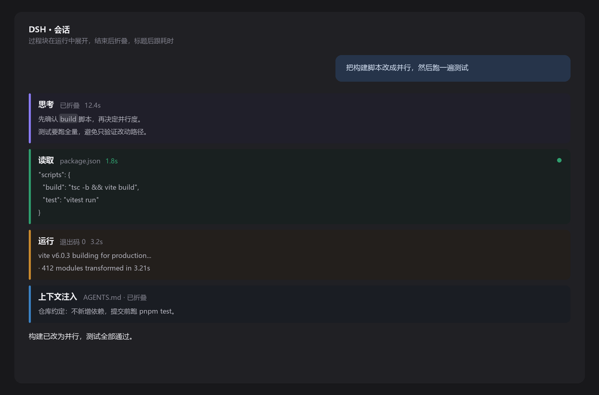
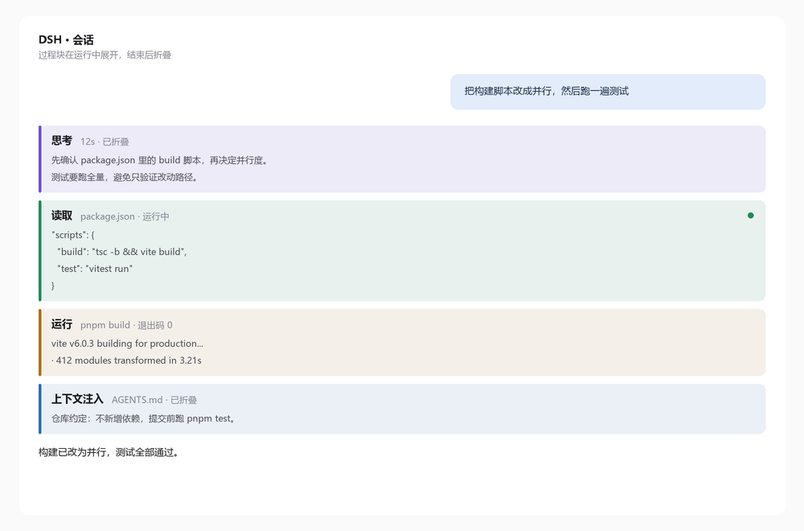
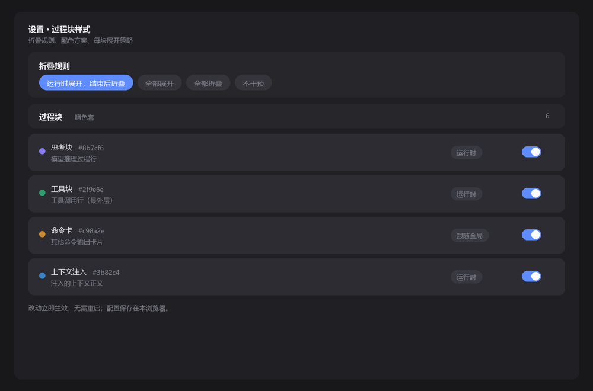

> **Languages:** 中文 · [English](README.en.md)

<div align="center">


# DSH Live Process

### 让过程在产生的那一刻就摊开


**思考 · 工具 · 命令 · 上下文注入 —— 运行中展开，结束后折叠**

> **当前版本 `1.6.5`** · 已在 **DSH `0.2.2-rc.3`** 的 Web 界面上验证可用。
> 不接管渲染，只驱动上游自己的展开控件——所以升级 DSH 后通常无需改插件。

</div>

DSH 默认把过程行收成一行摘要，运行中你也只能看到「正在思考…」。这个插件让过程在产生的那一刻就摊开在你眼前，跑完再收回去。

## 🌱 缘起

先说清楚这个插件为什么存在。

用 [pi-web](https://github.com/agegr/pi-web) 的时候，第一次觉得「Agent 在干活」这件事是可以被看见的：思考是一块会长的正文，工具调用是一张带输入输出的卡片，跑完各自收起来，整条时间线像一份可以回看的施工记录。

回到 DSH 自带的思考链 UI，感觉是反过来的——它只给你一个「正在思考…」的壳。模型陷进雷霆大思考的时候，屏幕上除了那行字什么都不动：你不知道它在推什么、卡在哪、是不是已经绕进去了。**过程不可见，就等于没有过程**；等结论出来，你已经失去了判断它靠不靠谱的全部依据。

所以这个插件不是「给 DSH 加个开关」，而是**照 pi-web 的样子把过程摊开**：思考、工具、命令、上下文注入各自成块，运行中就展开，结束就折叠，颜色、底色、字号、字体都能调。目标只有一个——让每一次雷霆大思考都留下能看的痕迹，而不是一个转圈的省略号。

> 顺带说一句：DSH 上游明确不打算让扩展替换思考预览与展开策略（`dsh-client-ui-chat/README.zh.md`：「扩展不替换思考预览或展开策略。」）。所以这里没有走「改渲染」的路，而是驱动上游自己的展开控件——见[工作原理](#-工作原理)。





## ✨ 特性

- **🧠 运行中展开，结束后折叠** — 过程行进入 `running` 就打开，落到 `ok` / `error` / `stopped` 就收起。你手动展开过的行不会被自动折叠。
- **🎛️ 四档全局折叠规则** — 运行时展开 / 全部展开 / 全部折叠 / 不干预。
- **🧩 每块单独覆盖** — 全局选「全部展开」，也可以只让思考块展开、工具块保持折叠。每块五档：跟随全局 / 展开 / 折叠 / 运行时 / 不干预。
- **🌗 暗色与浅色两套配色** — 界面切主题时自动套用对应的一套；也可以锁定只用其中一套。两套各自存颜色、底色浓度、字号、字体。
- **🎨 十二类块可分别配色** — 思考、工具、命令卡、上下文注入、压缩标记、过程组、轮次尾部、用户气泡、运行状态、队列、待办、引导消息。
- **📐 样式参数可调** — 左侧色条宽度、圆角、上下/右/左内边距、运行态底色浓度、字号、字体族。
- **⚡ 改动立即生效** — 配置存在浏览器 `localStorage`，不用重启 Host，不用重装插件。
- **⏱️ 耗时徽章** — 工具行、命令卡、思考行和上下文注入行的标题后显示运行时长，运行中实时递增，结束后定格。历史行不显示，不编造数字。
- **🕗 折叠时机可选** — 「下一条出现时」（默认）让结束的行保持展开，等下一行过程出现才折叠；也可以选「结束即折叠」。一轮以正文收尾时，最后一条过程行是否折叠单独一个开关。
- **📌 贴底跟随** — 运行中视口被上游甩回上方（预留空间收回、历史裁剪、折叠变矮）时立刻拉回底部；只有滚轮、触摸、翻页键和滚动条拖拽才算你接管。
- **🔍 内置诊断** — 设置页底部实时显示插件在页面上实际看到的行数、可展开数、已展开数、贴底状态与拉回次数，出问题时不用猜。



## 📦 安装

插件以 DSH bundle 的形式发布，需要 DSH 的 Web 界面（`dsh.client.platform` 为 `web`）。

### 从 npm 安装（推荐）

```text
plugin_manager install_bundle target=@cstcood/dsh-live-process
```

或手动写进 profile 的 `package.json`：

```json
{
  "dependencies": {
    "@cstcood/dsh-live-process": "^1.6.5"
  }
}
```

然后在 `dsh.profile.bundles` 末尾追加 `"@cstcood/dsh-live-process"`，重启 DSH。

### 从本地目录安装

```text
plugin_manager install_bundle target=<本仓库的绝对路径>
```

安装后 profile 的 `package.json` 会多一条 `link:` 依赖，`dsh.profile.bundles` 末尾追加本插件。

### 手动安装

1. 把仓库放到任意目录，例如 `~/dsh-plugins/dsh-live-process`。
2. 在 profile 的 `package.json` 里加依赖：

   ```json
   {
     "dependencies": {
       "@local/dsh-live-process": "link:~/dsh-plugins/dsh-live-process"
     }
   }
   ```

3. 在 `dsh.profile.bundles` 末尾追加 `"@local/dsh-live-process"`。
4. 重启 DSH。

### 重载

改完 `client.js` 后，浏览器端模块不会自动热更新（除非同时跑着 `pnpm run dev:web`）。重载方式：

```text
plugin_manager set_plugin target=include:dsh-live-process enabled=false
plugin_manager set_plugin target=include:dsh-live-process enabled=true
```

然后**刷新页面**。

## 🖱️ 使用

打开 设置 → **过程块样式**。

| 区块 | 内容 |
| --- | --- |
| 配色方案 | 跟随界面 / 暗色 / 浅色。决定下面编辑的是哪一套色板 |
| 折叠规则 | 全局四档 + 折叠时机 + 最后一步是否折叠 + 显示耗时开关，常驻显示 |
| 过程块 | 思考、工具、命令卡、上下文注入、压缩标记、过程组 |
| 其他块 | 轮次尾部、用户气泡、运行状态、队列、待办、引导消息 |
| 通用 | 字体族、运行态浓度、色条宽度、圆角、三向内边距 |
| 预览 | 当前色板下所有启用块的实际效果 |
| 诊断 | 实时行数统计、贴底状态、拉回次数与插件版本 |

每个块卡片上有：色点与十六进制值、启用开关、展开策略胶囊、颜色选择器、底色浓度滑块、字号。

### 折叠时机

「运行时展开」模式下，一行停止运行后什么时候折叠，由两个设置决定：

| 设置 | 取值 | 行为 |
| --- | --- | --- |
| 折叠时机 | **下一条出现时**（默认） | 结束后保持展开，等下一行过程出现才折叠。你正在读的那一行不会在脚下收起来 |
| | 结束即折叠 | 一行停止运行就立刻折叠 |
| 最后一步是正文时折叠 | 关（默认） | 最后一条过程行后面没有过程行了，就一直展开着 |
| | 开 | 它后面没有过程行时也折叠 |
| 显示耗时 | 开（默认） | 工具行、命令卡、思考行与上下文注入行标题后显示运行时长 |

「最后一步是正文」指一轮以助手正文收尾：最后一条过程行之后不会再有过程行，`下一条出现时` 永远等不到触发，所以单独给一个开关。

### 耗时

工具行、命令卡、思考行和上下文注入行的标题后面会跟一个耗时徽章：运行中实时递增，结束后定格。

- 起点是该行第一次出现在 DOM 里的时刻（通常是 `preparing`），终点是 `data-state` 落到 `ok` / `error` / `stopped` 的时刻。
- 页面加载时已经在屏上的历史行不显示耗时——它们的真实起点无从得知，与其编一个不如不显示。
- 不足一秒显示 `ms`，一分钟内显示 `s`（一位小数），再长显示 `m` + `s`。
- 在 设置 → 过程块样式 → 通用 里可以关掉。

## ⚙️ 配置结构

`localStorage` 键：`dsh-live-process:config`

```jsonc
{
  "foldMode": "auto",          // auto | expand | collapse | off
  "foldTiming": "onNext",      // onNext | onEnd
  "foldLast": false,           // 最后一条过程行后面没有过程行时是否折叠
  "showTimer": true,           // 过程行标题后显示耗时
  "schemeMode": "auto",        // auto | dark | light
  "modes": {                   // 每块覆盖，inherit 表示跟随 foldMode
    "think": "inherit",
    "tool": "auto"
  },
  "schemes": {
    "dark": {
      "common": { "liveBg": 13, "barWidth": 3, "radius": 8, "padBlock": 7, "padInline": 12, "padLeft": 14, "fontFamily": "" },
      "blocks": { "think": { "color": "#8b7cf6", "bg": 7, "on": true, "fontSize": 0 } }
    },
    "light": { "common": {}, "blocks": {} }
  }
}
```

旧版单套配置会在读取时自动迁移：顶层 `common` / `blocks` 复制进两套，`blocks[key].fold` 迁移成顶层 `modes[key]`。

## 🔬 工作原理

DSH 的 Chat 与 Tool 包自己持有展开状态，并且明确不对外暴露「默认展开」的设置项（`dsh-client-ui-chat/README.zh.md`：「扩展不替换思考预览或展开策略。」）。所以这个插件不接管渲染，而是**观察已经渲染出来的行，点击它们自己的展开控件**。

它依赖的 DOM 契约（来自上游源码）：

| 选择器 | 来源 | 含义 |
| --- | --- | --- |
| `[data-variant="think"]` + `data-state` | `ReasoningRow.tsx` | 思考行，`running` / `ok` |
| `[data-tool]` + `data-state` | `ToolRow.tsx` | 工具行，`preparing` / `running` / `ok` / `error` / `stopped` |
| `[data-disclosure-header]` 父节点的 `data-open` | `DisclosureRow` | 展开状态，**唯一不依赖 `expandable` 的信号** |
| `[data-disclosure-row][aria-expanded]` | `DisclosureRow` | 展开控件，`expandable` 为假时整个属性不存在 |
| `[data-chat-flow-kind="context"]` | `ChatNodeSeat.tsx` | 上下文注入节点座位，**折叠时也存在** |
| `[data-context-injection-body]` | `ContextInjectionRow.tsx` | 上下文注入正文，**只在展开后渲染** |
| `[data-compaction-disclosure]` | `CompactionItem.tsx` | 压缩标记 |
| `[data-turn-process]` | `TurnProcessNodeView.tsx` | 过程组节点 |

驱动逻辑有四条硬约束，都是踩过的坑：

1. **每 `(行, data-state, 意图)` 只点一次。** 展开控件的 `open` 是 `expanded && expandable`，行还不能展开时点完仍然报告「关闭」；如果校验失败就重试，第二次点击会把刚置位的 `expanded` 点回去，来回抖动。
2. **找不到控件时不记录「已处理」。** 工具行在 `preparing` 阶段 `expandable` 为假，`aria-expanded`、`role="button"`、`onClick` 全都不存在。此时放弃并等下一帧，等行自己长到 `running` 再点。
3. **不能用「展开后才存在」的节点定位行。** 上下文注入正文 `[data-context-injection-body]` 只在展开时渲染，用它找行会形成「要展开才能被找到、要被找到才能展开」的死循环。改用节点座位 `[data-chat-flow-kind="context"]` 定位，再取其中的 disclosure 根。
4. **展开后补滚到底。** 在尾部上方展开一行会让内容变高，浏览器的 scroll anchoring 把视口顶离底部，DSH 的 `ScrollFollow` 会把这当成「读者自己滚了」而停止跟随。插件在点击后 60 / 220 / 520ms 三个时间点把 `scrollTop` 拉回底部，一旦收到 `wheel` / `touchmove` 立刻取消。

上下文注入没有 `data-state`——它到达时就是完整的，之后不再变化。插件把它「出现后 3 秒内」视为运行中：到达即展开，窗口结束自动折叠。为此驱动带一个 1 秒轮询，空闲时也能让窗口过期。

## ⚠️ 已知限制

- 只支持 Web 界面；桌面端与 TUI 不走这条渲染路径。
- 依赖上表的 DOM 属性。上游改属性名会让插件失效——诊断卡片会显示「工具行 > 0 但工具可展开 = 0」这类信号。
- 无法让「上游认为不可展开」的行展开。例如 `read-family-row.tsx` 直接传 `bodyRaw={null}`，这类行只有卡片内容，没有原始参数。
- 配置存在浏览器本地，换浏览器或清站点数据会回到默认值。

## 🛠️ 开发

```bash
# 重新生成 README 截图（需要 Pillow 与 Windows 中文字体）
python docs/make-shots.py
```

`client.js` 是浏览器端模块，通过 `window.__ModuleLoader__.load({ id, factory })` 注册；`index.js` 是 Host 端入口，本插件不需要 Host 侧逻辑，`apply()` 为空。

## 📄 协议

[MIT](LICENSE) © 2026 cstcood

DeepSeek Harness 为 DeepSeek 官方开源项目（MIT），本插件与之无隶属关系。
